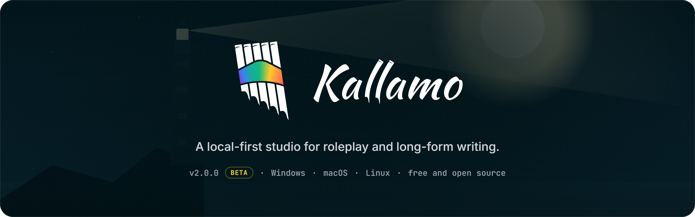
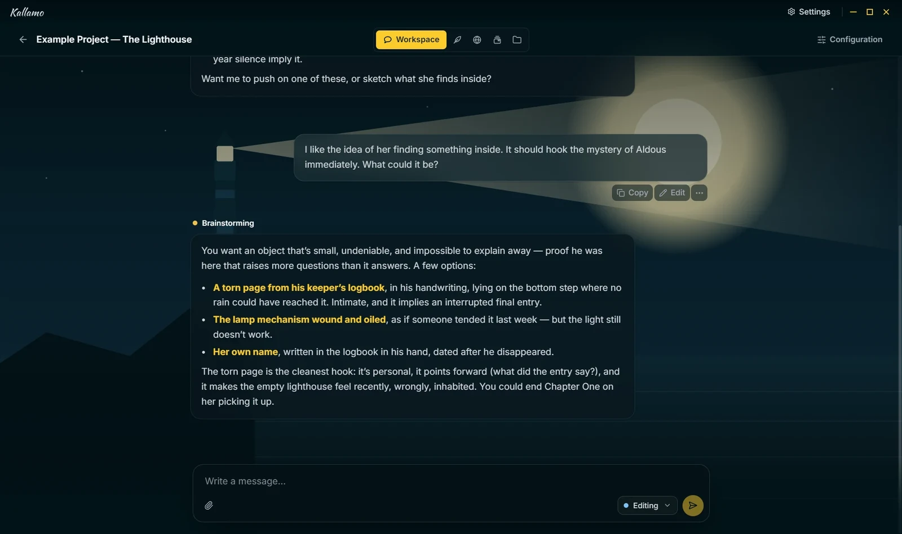
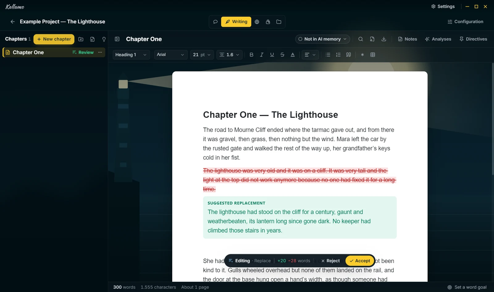
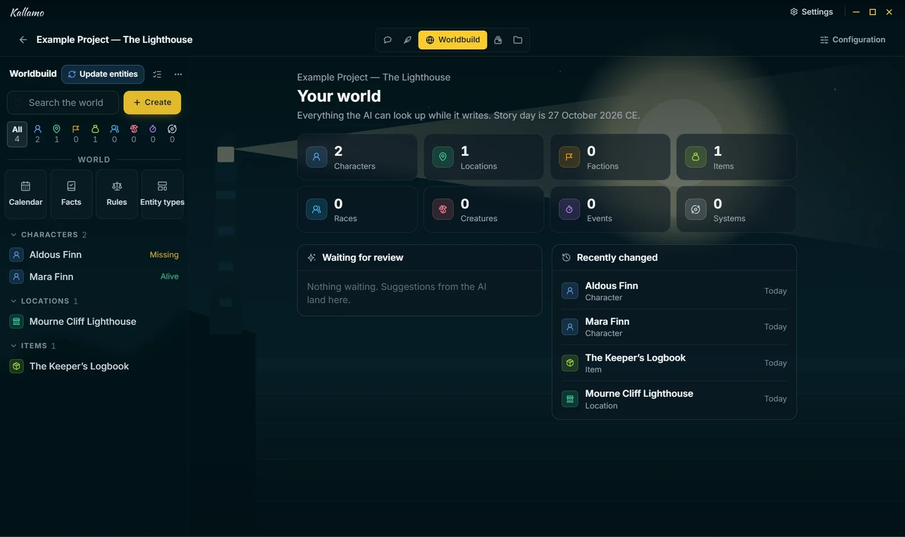
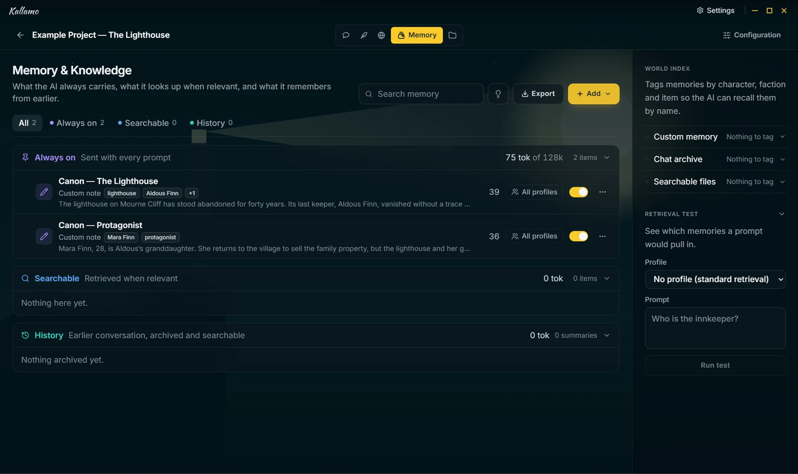
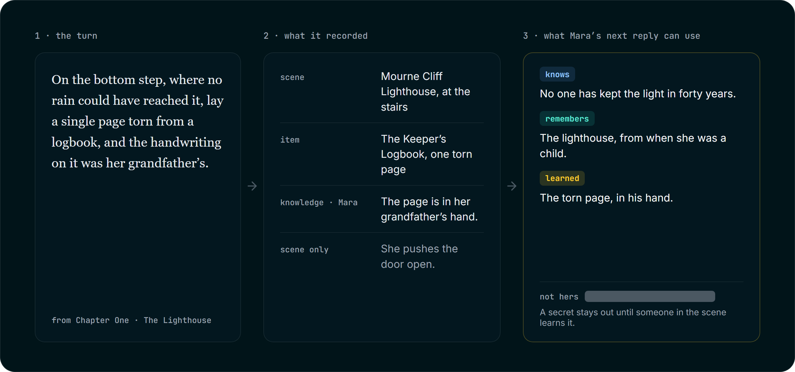
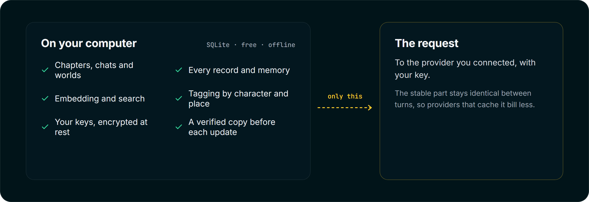
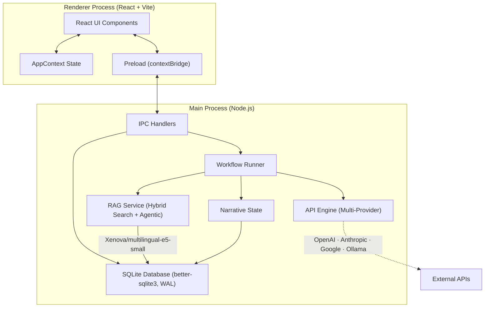

<a href="https://kallamo.com"></a>

<p align="center">
  <a href="https://kallamo.com/download/"><b>Download</b></a>
  &nbsp;·&nbsp;
  <a href="https://kallamo.com">Website</a>
  &nbsp;·&nbsp;
  <a href="https://kallamo.com/docs/">Docs</a>
  &nbsp;·&nbsp;
  <a href="https://discord.com/invite/CE4C9JRS9H">Discord</a>
</p>

<p align="center">
  <a href="https://github.com/Kallamo/Kallamo/releases"></a>
  <a href="LICENSE"></a>
  <a href="https://discord.com/invite/CE4C9JRS9H"></a>
  <a href="https://github.com/Kallamo/Kallamo"></a>
</p>

Kallamo is a local-first studio for roleplay and long-form writing. After every reply it writes down what happened, where and when, and who was there to see it, so each character answers only from their own part.

You bring the model and the key. Your chapters, chats, worlds and every record stay in a database on your computer.

## Every story gets a workspace with four rooms

The chat, the manuscript, the world and the memory share one canon.

<table>
  <tr>
    <td width="50%" valign="top">
      
      <p><b>Chat</b><br />Write or play with your AI profiles. Each one has its own voice, rules, model and knowledge.</p>
    </td>
    <td width="50%" valign="top">
      
      <p><b>Writing Desk</b><br />Chapters with the AI beside the page. It touches only the passage you choose, as a suggestion you accept or reject.</p>
    </td>
  </tr>
  <tr>
    <td width="50%" valign="top">
      
      <p><b>Worldbuild</b><br />The canon: characters, places, factions and items, with a calendar and the rules of the world. A whole world travels as one <code>.klwb</code> file.</p>
    </td>
    <td width="50%" valign="top">
      
      <p><b>Memory</b><br />What the AI always carries, what it looks up when it is relevant, and what it remembers from earlier.</p>
    </td>
  </tr>
</table>

## The Narrative State keeps the story straight

After each roleplay reply, Kallamo reads the turn and writes the story down: the scene, the clock, inventories and relationships, and what every character now knows, believes and remembers. The next reply is built from that record, one perspective at a time.



- **Knowledge cards.** What a character knows about a subject: that it exists, which of its fields, which of its connections.
- **Facts apart from beliefs.** Canonical facts are kept separate from what anyone knows, believes or remembers.
- **Shared by belonging.** Factions share with their members, regions and areas with the people who live there.
- **Only what lasts.** Where someone stands right now stays in the scene. Records are kept for what holds.

## Roleplay with a world that keeps time

Turn any workspace into a story you play. Pick your character and set the scene, and a clock keeps time on your world's own calendar.

- **The scene.** Location, who is present, the objects in the room and what you carry, updated after every reply and editable by hand.
- **Story time.** When the story doesn't say how long something took, the clock moves by the kind of action. Time written in the story always wins.
- **Rules of the world.** Resources such as health or mana, levels and attributes, and skills with your own rank names.
- **Review.** Big changes, like a secret coming out, wait for your approval. Regenerating a reply first undoes the state of the one it replaces.

## Your stories stay on your machine



Connect OpenAI, Anthropic, Google AI, Vertex AI, AWS Bedrock, OpenRouter, Ollama, LM Studio or any compatible server. Embedding, search and tagging run on your computer, free and offline.

## Download

Kallamo opens with **The Lighthouse**, a chapter to edit, and **Evenwell**, a roleplay to play. Connect a model and the first story is already waiting.

| System | File | Updates |
|--------|------|---------|
| Windows | `Kallamo Setup X.X.X.exe` | Updates itself when it opens |
| macOS | `Kallamo-X.X.X.dmg` | Download each release |
| Linux | `Kallamo-X.X.X.AppImage` or `kallamo_X.X.X_amd64.deb` | The AppImage updates itself |

**[Get Kallamo for your computer](https://kallamo.com/download/)**, or find every file on the [latest release](https://github.com/Kallamo/Kallamo/releases/latest).

## Documentation

How to use Kallamo, from connecting a model to exporting a world, lives at **[kallamo.com/docs](https://kallamo.com/docs/)**.

The design notes in [`docs/`](docs/) are for contributors. Each one records the rules a system must keep, so read it before changing that area.

| Design note | What it covers |
|-------------|----------------|
| [Narrative State](docs/narrative-state.md) | Durability taxonomy, quality gate, review queue, story clock |
| [Agentic Retrieval](docs/agentic-retrieval.md) | Retrieval planner gate, budgets, tool protocols, token calibration |
| [Prompt Caching](docs/prompt-cache.md) | Stable head and volatile tail, breakpoints, lifetime, history anchoring |

## Build from source

Electron, React and SQLite. Node 18 or newer.

<details>
<summary><b>Install and run</b></summary>

### Prerequisites

- **Node.js** 18 or newer
- **Python** 3.10 or newer and C++ build tools, only if a prebuilt `better-sqlite3` binary is unavailable for your platform
  - Windows: install the Visual Studio Build Tools
  - macOS: `xcode-select --install`
  - Linux: `sudo apt-get install build-essential python3`

### Installation

```bash
git clone https://github.com/Kallamo/Kallamo.git
cd Kallamo
npm install
```

`npm install` also prepares the two SQLite binaries the project needs. `better-sqlite3`
is compiled against a V8 ABI, and Electron and Node do not share one, so the app and the
test runner each get their own copy under `prebuilds/` and neither has to rebuild over
the other. If that step is skipped or fails, run it on its own:

```bash
npm run setup:sqlite
```

### Development

```bash
# Vite dev server and Electron together
npm run electron:dev

# Test suite (Vitest)
npm test
```

The Vite server runs on `localhost:5173` and Electron opens pointing to it, so changes to React components show up at once.

### Building

```bash
# Build the Vite bundle and launch Electron from dist/
npm run start

# Unpacked build, for testing
npm run pack

# NSIS installer and auto-update metadata
npm run dist
```

`npm run dist` writes the `Kallamo Setup X.X.X.exe` installer and its `latest.yml` to `release/`.

</details>

<details>
<summary><b>Architecture</b></summary>

<br />

Kallamo follows Electron's two-process model with a strict security boundary between the renderer and the backend.



| Layer | Responsibility | Key files |
|-------|----------------|-----------|
| **Renderer** | React UI, state management, user interactions | `App.jsx`, `AppContext.jsx`, component tree |
| **Preload** | Secure IPC bridge via `contextBridge` | `preload.js` |
| **IPC Handlers** | CRUD operations, file indexing, import and export | `ipc-handlers.js` |
| **Workflow Runner** | Runs replies, prompt chains and the roleplay analysis | `workflow-runner.js` |
| **Narrative State** | Routing, quality gate and store for what a turn records | `features/narrative/`, `src/narrative/` |
| **RAG Service** | Chunking, vectorization, hybrid search, memory management | `rag-service.js`, `features/knowledge/` |
| **API Engine** | Provider request formatting, auth, response parsing, payload limits | `features/llm/llm.service.js` |
| **Database** | Schema, migrations, encryption helpers | `database.js` |

</details>

<details>
<summary><b>Project structure</b></summary>

```
Kallamo/
├── src/
│   ├── main.js                  # Electron entry point, splash, window management
│   ├── preload.js               # Secure IPC bridge (contextBridge)
│   ├── main/
│   │   ├── database.js          # SQLite schema, migrations, encryption
│   │   ├── workflow-runner.js   # Replies, chains, agentic retrieval loop
│   │   ├── rag-service.js       # Vector engine and hybrid search
│   │   ├── entities.js          # Worldbuild entity and relation registry
│   │   ├── writing-desk-invocation.js # AI select and invoke for the Writing Desk
│   │   ├── ipc-handlers.js      # All IPC endpoint definitions
│   │   └── features/            # Domain modules
│   │       ├── llm/             # Multi-provider API client, payload budget, token calibration
│   │       ├── knowledge/       # Retrieval ranking, context packing, retrieval planner
│   │       ├── narrative/       # Narrative State routing, quality gate, store
│   │       ├── world-index/     # Tagger and entity name tags
│   │       ├── worldbuild/      # Entity fields, lore and update review
│   │       └── chat/            # Live history and archive coverage
│   ├── renderer/
│   │   ├── App.jsx              # Root layout, global effects
│   │   ├── main.jsx             # React DOM entry
│   │   ├── index.html           # HTML shell
│   │   ├── index.css            # Global styles (Tailwind v4)
│   │   ├── context/             # React Context (AppProvider)
│   │   ├── components/          # UI components
│   │   └── utils/               # Client-side utilities
│   ├── narrative/               # Narrative State contracts, taxonomy, validation
│   ├── splash/                  # Launch window and update progress
│   └── assets/                  # Icons and static assets
├── docs/                        # Design notes for contributors
│   ├── agentic-retrieval.md     # Retrieval planner design and budgets
│   ├── narrative-state.md       # What the roleplay analysis may store, story clock
│   └── prompt-cache.md          # Request layout for provider prompt caching
├── build/                       # Installer art and NSIS include
├── tests/                       # Vitest suite (npm test)
├── release/                     # Build output (installer, unpacked app)
├── vite.config.js               # Vite build configuration
└── package.json
```

</details>

<details>
<summary><b>Tech stack</b></summary>

<br />

| Category | Technology | Purpose |
|----------|------------|---------|
| **Runtime** | Electron 31 | Desktop shell, native OS integration |
| **Frontend** | React 19, Vite 8 | UI rendering, hot module replacement |
| **Styling** | Tailwind CSS v4 | Utility-first CSS |
| **Database** | better-sqlite3 (WAL mode) | Synchronous SQLite with FTS5 |
| **Embeddings** | `@huggingface/transformers` | Local multilingual embeddings (multilingual-e5-small) |
| **Document parsing** | mammoth, unpdf | DOCX and PDF text extraction |
| **Packaging** | adm-zip | `.klp`, `.klw`, `.klkb` and `.klwb` export and import |
| **Installer** | electron-builder (NSIS) | Windows installer |
| **Auto-update** | electron-updater | Updates through GitHub Releases |
| **Code highlighting** | highlight.js | Syntax highlighting in chat messages |
| **Icons** | lucide-react | SVG icon set |

</details>

## Community

- **[Kallamo's community on Discord](https://discord.com/invite/CE4C9JRS9H)**: writers, game masters and roleplayers sharing worlds, profiles and help.
- **[Issues](https://github.com/Kallamo/Kallamo/issues)** for bugs and requests.
- A **[star](https://github.com/Kallamo/Kallamo)** is how other writers and roleplayers find Kallamo.

## License

Kallamo is licensed under the [GNU AGPLv3](LICENSE).

The name **Kallamo**, the logo and the rest of the brand are trademarks of the project creator and are not covered by the license. A fork or modified version has to be renamed and rebranded so nobody mistakes it for Kallamo.

Contributions need the [Contributor License Agreement](CLA.md). The [Privacy Policy](PRIVACY.md) says what Kallamo does, and does not do, with your data.
